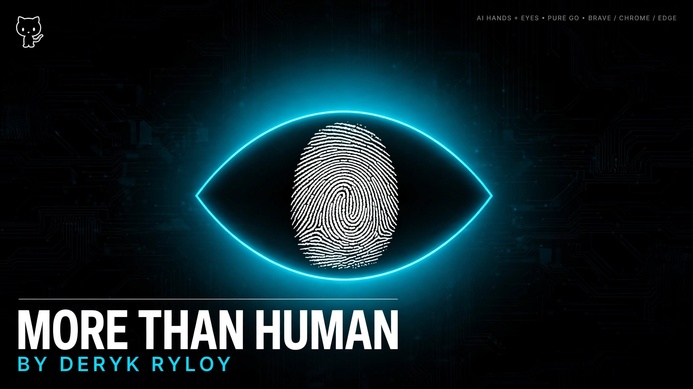
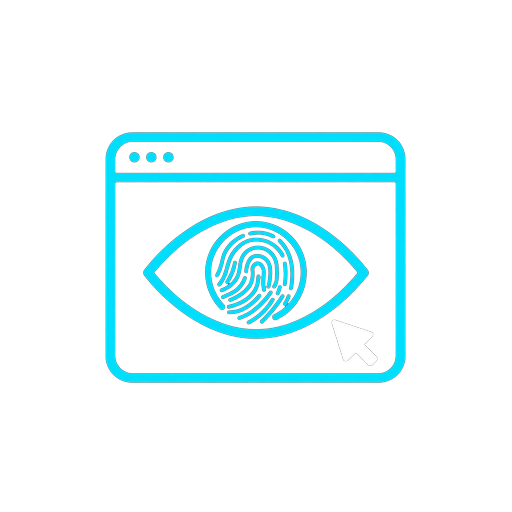
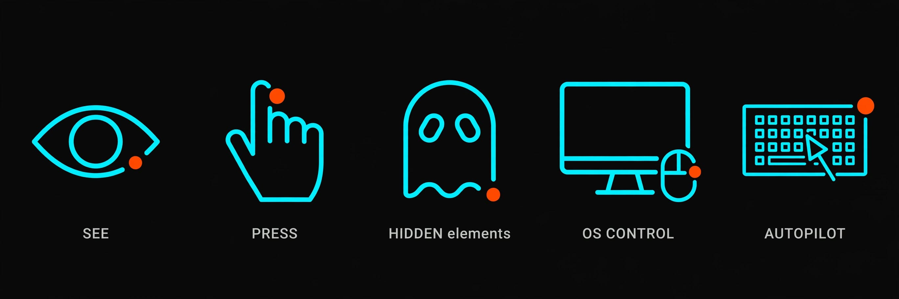
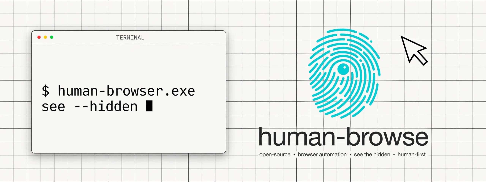

<p align="center">
  
</p>

<h1 align="center">MORE THAN HUMAN</h1>
<p align="center"><i>Give any AI hands and eyes for any browser. It sees everything — including the invisible — and presses anything, exactly like you would.</i></p>

<p align="center">
  
  
  
  
</p>



## Why this exists

Browser automation has been stuck for a decade: frameworks that only see the DOM, need drivers, break on anything visual, and go blind the second an element is hidden, covered, or living outside the page (address bar, menus, dialogs, OS popups).

**MORE THAN HUMAN is the other approach.** One small Go binary with no dependencies gives an AI agent a real pair of eyes and a real pair of hands:

- **EYES** — page screenshots plus full-screen screenshots, every DOM element with coordinates and text, **including invisible ones** (`display:none`, `opacity:0`, `aria-hidden`, zero-size, offscreen), each labeled with *why* it's hidden.
- **HANDS** — real Chromium input events *and* real OS-level mouse/keyboard, so it can press anything from a buried `<div>` to the browser's own back button.
- **BRAIN** — an autopilot sector that reads a site's own answer key from the DOM, refuses damaged runs, types at a commanded pace, and verifies itself with zero screenshots mid-run.

No Python. No Node. No drivers. No CGO. Just Go.

**No speed limits in the tool itself** — pour a whole text in a single blast
or cruise at a human pace; either way it lands at 100% accuracy.

## Why it wins

| | Selenium / Playwright / Puppeteer | MORE THAN HUMAN |
|---|---|---|
| Sees hidden & covered elements | No — invisible is unclickable | **Yes, with reasons** (`hiddenWhy`) + `jsclick` |
| Controls the browser chrome itself | No — page only | **Yes — OS-level mouse/keyboard, address bar to dialogs** |
| Works without drivers / runtimes | No — drivers, Node, browsers to manage | **Single ~12 MB binary** |
| Verifies its own work | Screenshots you must eyeball | **Reads page state from the DOM: cursor + error counts** |
| Recovers from failure | Your code's problem | **Self-heal: Redo + retry automatically** |
| Recorded proof | Benchmarks on toy pages | **100% accuracy on live 1,200+ character tests** |
| Numbers you can check | Marketing charts | **[BENCHMARKS.md](docs/BENCHMARKS.md): 248 keys/sec measured, rerun in 30s** |



**SEE everything**
```powershell
human-browser see --port 9222 --hidden --shot page.png --max 200   # screenshot + ALL elements + text
human-browser screen --out screen.png                               # whole screen, browser chrome included
human-browser elements --port 9222 --hidden --find "login"
human-browser find --text "Start Test" --port 9222                 # exact coordinates, no guessing
```

**PRESS anything**
```powershell
human-browser click --x 512 --y 639 --port 9222
human-browser jsclick --index 18 --port 9222      # even invisible / covered
human-browser type --text "hello" --port 9222
human-browser ctype --text "exact..." --wpm 50 --port 9223   # batch, self-verified
human-browser mouse --click left --x 300 --y 60   # real OS mouse (browser UI itself)
human-browser key --combo ctrl+l                  # real OS keyboard
```

**AUTOPILOT — the recorded perfect-pass sector**
```powershell
human-browser autopilot --guide                                   # the full playbook
human-browser tpass --port 9223 --tab ID --wpm 50 --chars 1245    # whole pass, one call
human-browser tpass --dry --port 9223 --tab ID                    # extract + validate only
```

**Full command reference**
`launch` `tabs` `goto` `back` `forward` `reload` `new-tab` `close` `activate` `see` `screen` `elements` `text` `find` `click` `jsclick` `type` `press` `ctype` `hover` `scroll` `eval` `mouse` `key` `windows` `focus` `minimize` `sendkeys` `chain` `racetype` `shotclean` `wait` `waitfor` `downloads` `ask` `adopt` `quit` `doctor` `serve` — every command prints JSON.



## Launch (once)

```powershell
human-browser launch --port 9222 --url https://example.com
human-browser tabs --port 9222
```

Auto-finds Brave, Chrome, or Edge (Windows/macOS/Linux paths). Already have a
browser open with your real profile? `adopt --port 9223` migrates it gracefully
(WM_CLOSE flush, same profile, tabs restored) instead of killing it.

## HTTP API for any agent

```powershell
human-browser serve --api 8080 --port 9222
# GET /see /screen /tabs /windows   POST /act {"action":"click","x":512,"y":639}
```

## Not on Windows?

CDP control works everywhere. OS hands are full on Windows; macOS/Linux ship
compiling stubs with identical CLI. Run `doctor --repair` — it diagnoses the
machine and prints the exact implementation checklist (AppleScript/JXA +
screencapture on macOS; X11/XTEST on Linux).

## Files

- `main.go` — CLI, every command JSON-first
- `cdp.go` — minimal CDP client (Page/Runtime/Input/Browser domains)
- `elements.go` — DOM enumerator, exact-coords finder, batch typer, autopilot engine
- `oscontrol.go` — Windows input/screenshot/window API · `os_other.go` — portable stubs
- `launcher.go` — cross-platform browser finder + debug launcher
- `server.go` — agent HTTP API

## License — free to use, not free to steal

Apache-2.0 (see LICENSE): **everyone may use, modify, and share this tool**,
commercially included. Two hard rules: keep the copyright notice, and **forks
must rename + rebrand** — the name MORE THAN HUMAN and the fingerprint-eye
artwork stay with this project. Build on the code all you want; you ship it
under your own name.

---
*Discovery tags: #browser-automation #ai-agents #rpa #web-automation #golang
#brave #chrome-devtools-protocol #desktop-automation #llm-agents #autopilot
#webscraping #uis #human-computer-interaction*
